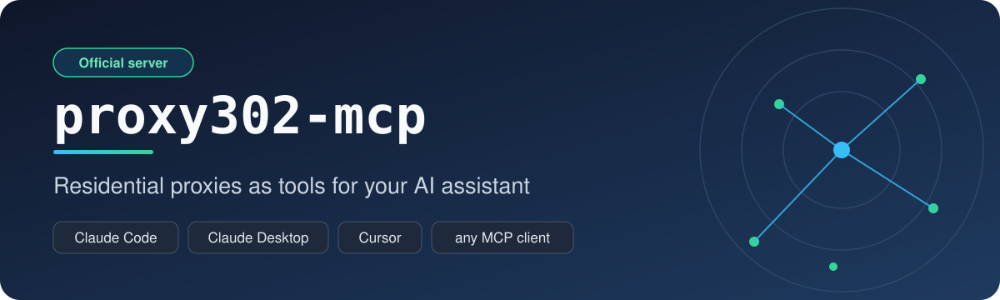

<p align="center"></p>

# proxy302-mcp

> **Proxy302 官方 MCP 服务器**，由 Proxy302 团队开发和维护。账户、计费、连接问题请联系 [Proxy302 客服](https://proxy302.com/zh/)；这个服务器本身的 bug 请提 [GitHub issue](https://github.com/proxy302/proxy302-mcp/issues)。

给你的 AI 助手一套真正的住宅代理工具。`proxy302-mcp` 是 [Proxy302](https://proxy302.com) 的 [MCP](https://modelcontextprotocol.io) 服务器：在 Claude Code、Claude Desktop、Cursor 等工具里查流量和用量、看可用国家和套餐、按国家拿动态住宅代理连接串、列出你的代理和静态 IP，还能通过代理抓取网页。

[English](README.md)

<p align="center"></p>

> v1 只做只读、不花钱的功能：不购买、不续费、不充值。唯一的写操作（创建动态代理凭证）免费、默认关闭，只在你真正使用时才按流量计费。

## 不用安装：直接连官方托管的服务器

Proxy302 在 `https://proxy302.com/v1/mcp` 托管了同一套服务（Streamable HTTP），在 Proxy302 控制台创建 API 密钥后，请求头带上 `Authorization: Bearer <key id>:<secret>` 即可。

```bash
claude mcp add --transport http proxy302 https://proxy302.com/v1/mcp --header "Authorization: Bearer <key id>:<secret>"
```

Cursor（`~/.cursor/mcp.json`）：

```json
{
  "mcpServers": {
    "proxy302": {
      "url": "https://proxy302.com/v1/mcp",
      "headers": { "Authorization": "Bearer <key id>:<secret>" }
    }
  }
}
```

托管版的工具和本地版一样，不含 `fetch_url`，另外多了 `rotate_ip`（粘性代理换一个出口 IP）、`check_ip_purity`（查你的静态 IP 或某个地区下一批 IP 的黑名单评分）、`estimate_cost`（按你的账户报价、看钱包够不够）。同样不会花钱。

## 在本机运行：一条命令安装

先在 Proxy302 控制台创建 API 密钥，记下 key id 和 secret。需要 Node.js 20+。

福利：付费账户第一次通过 proxy302-mcp 调用成功，Proxy302 会送 **1 PTC**（每个账户一次）。

```bash
claude mcp add proxy302 -e PROXY302_API_KEY="<key id>:<secret>" -- npx -y github:proxy302/proxy302-mcp
```

### Claude Desktop

```json
{
  "mcpServers": {
    "proxy302": {
      "command": "npx",
      "args": ["-y", "github:proxy302/proxy302-mcp"],
      "env": { "PROXY302_API_KEY": "<key id>:<secret>" }
    }
  }
}
```

### Cursor

把同样的片段放进 `~/.cursor/mcp.json`。

## 工具

| 工具 | 作用 |
|---|---|
| `get_account_usage` | 账号、钱包 PTC 余额、剩余预付流量、各流量包余额、最近 N 天用量 |
| `list_countries` | 可定向的国家（含 id 和 ISO 代码） |
| `list_regions` | 某国的州，或某州的城市 |
| `list_products` | 产品线与静态 IP 套餐 |
| `get_dynamic_proxy` | 按国家（支持的线路可到州/市）返回可直接使用的动态住宅代理 URL；优先复用已有代理，`create_if_missing=true` 时才创建 |
| `list_my_proxies` | 你的动态代理和静态 IP，密码默认打码 |
| `fetch_url` | 通过你的代理（可指定出口国家）请求网址，返回 Markdown、纯文本或原文 |

## 示例

<p align="center"></p>

直接问助手：「我还剩多少流量？」「给我一个德国代理」「用美国出口抓一下这个页面并总结」。

Playwright 与 browser-use 的用法见英文版 README：把 `get_dynamic_proxy` 返回的 host、port、用户名、密码填入浏览器的 proxy 配置即可。`fetch_url` 不执行 JavaScript，重度前端渲染的网站请把代理交给浏览器。

## 配置

- `PROXY302_API_KEY`：必填，`<key id>:<secret>`
- `PROXY302_API_SECRET`：可选
- `PROXY302_BASE_URL`：可选，默认 `https://proxy302.com`

密钥只从环境变量读取，不要提交到仓库。

## 许可证

MIT
